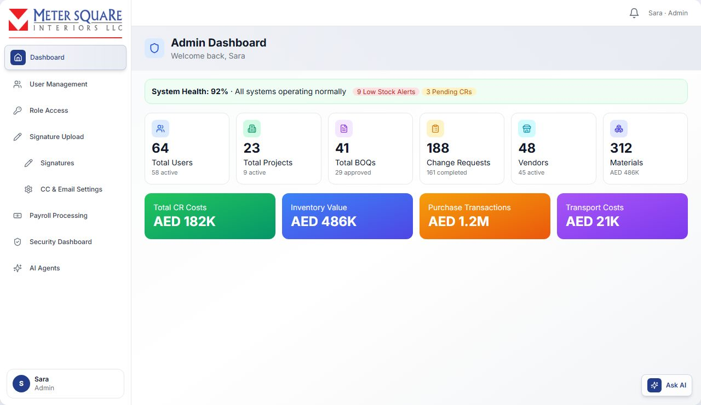
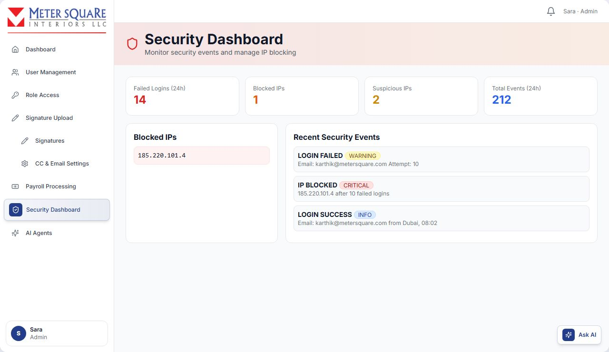

# Admin

The Admin manages people and system settings. Admin menu: **Dashboard**, **User Management**, **Role Access**, **Signature Upload** (Signatures, CC & Email Settings), **Payroll Processing**, **Security Dashboard**, and the "view as" role links.

## Admin Dashboard

The **Admin Dashboard** gives a company-wide overview.

- **Period selector**: Last 7, 14, 30 (default), 60 or 90 days, plus **Refresh**.
- **System Health**: an overall percentage with low-stock alerts and pending change requests.
- **KPI cards**: Total Users, Total Projects, Total BOQs (approved / pending), Change Requests (completed / pending), Vendors, Materials (stock value / low stock).
- **Financial cards**: Total CR Costs, Inventory Value, Purchase Transactions, Transport Costs.
- **Charts**: User Distribution, User Registration Trend, Change Request Activity, Daily Cost Trend, Project Status, Delivery Stats, Material Requests.
- **Lists**: Top Project Managers, Top Site Engineers, Login Activity (Email OTP vs SMS OTP) and Pending CR Approvals by stage.

## User Management

Open **User Management** to see all users.

- Search with **Search users...**, filter by **All Roles** (with user counts) and **All Status** (Active / Inactive). Active filters show as chips; click **Clear all** to remove them.
- The table shows User (with a red **Blocked** tag if blocked), Email, Role, Department, Status and Last Login.
- 20 users per page.

### How to create a user

1. Click **Add User**.

2. Fill in **Email** (must not already exist), **Full Name**, **Role**, and optionally **Phone** and **Department** (if left blank, the department is set to the role name).

3. Click **Create**. You see **User created successfully**. The user is created as Active.

4. A one-time sign-in code (OTP) is emailed to the user straight away.
5. The user signs in by choosing their role and entering their email. There is no password. If the first code has expired, they click **Send OTP** for a new one.

### How to activate or deactivate a user

1. Click the user's **Active** / **Inactive** status pill. The change is immediate.

2. The user is emailed about the change.

A deactivated user cannot sign in ("Email not found") and any open session stops working. You cannot deactivate yourself.

### How to block or unblock a user

1. In the **Last Login** column, click the orange shield (**Block user**).
2. Enter a reason (default "Blocked by administrator") and click OK.

3. The user is signed out, set Offline and emailed with the reason. When they try to sign in they see **Account Blocked**.

To unblock, click the green shield (**Unblock user**) and confirm. The user is emailed and can sign in again.

**Block or deactivate?** Deactivate makes the account inactive. Block keeps the account but refuses access and marks it **Blocked** with a reason.

You cannot block yourself.

### Login history

Click a user's **Last Login** to open **Login History**. Each sign-in shows:

- date and time, device (desktop, mobile or tablet), browser, operating system and IP address;
- the method (**Email OTP** or **SMS OTP**);
- a status: **Active** (session in use), **Logged Out** (signed out normally) or **Expired** (ended by a force logout, a block or the time limit).

### Online status and force logout

1. Click **Online Status** to see who is online (device, browser, IP, since when) and who is offline (last seen).

2. To end someone's session, click the red log-out icon (**Force logout**) next to an online user and confirm.

3. Their session ends immediately. On their next action they return to the login page with "Your session was ended by an administrator".

You cannot force-log-out yourself.

### Security Alerts

Click **Security Alerts** (the badge shows unresolved alerts). Alerts are raised automatically at sign-in:

- **multiple ips** (high): sign-ins from 3 or more different IP addresses within 24 hours.
- **unusual hours** (medium): a sign-in between 00:00 and 05:59 UTC.
- **rapid logins** (high): 5 or more sign-ins within 5 minutes.

Review an alert and click the green tick (**Mark as resolved**). Use **Show All** to include resolved alerts.

### Editing user details

User Management does not have an edit button for name, phone, role or department. Users can update their own name, email, phone and department from **Profile Settings**. To give someone another role temporarily, use **Role Access**.

## Role Access (temporary extra roles)

Role Access lets an Admin or Technical Director give a user temporary access to another role. The user keeps their own role and signs in with the same email.

The page shows:

- **Cards**: Active now, Ending within 3 days, Scheduled, Expired or revoked.
- **Tabs**: Active, Scheduled, Paused, Expired, Revoked, All.
- **Table columns**: User (own role), Granted role, Access type, Period, Status, Granted by, and the row actions.

### Row actions

| Action | Shown for |
|---|---|
| **Extend** | Active |
| **Edit** | Active, Scheduled, Paused |
| **Pause** | Active, Scheduled |
| **Resume** | Paused |
| **Renew** | Expired, Revoked |
| **Revoke** | Active, Scheduled, Paused |

Only people whose **own** role is Admin or Technical Director can manage Role Access. Someone working in a granted Admin or TD role cannot.

### Status badges

| Badge | Meaning |
|---|---|
| Active · N days left | Access is in use |
| Ends in N days / Ends today | Active, 3 days or fewer left |
| Starts <date> | Scheduled to start later |
| Paused | Stopped for now by Admin or TD. The row shows who paused it. |
| Expired | The end date has passed |
| Revoked | Removed early by Admin or TD |

### How to grant role access

Open **Role Access** and click **Grant role access**. A step-by-step wizard opens. The step bar at the top shows your progress: click a completed step to go back, use **Back** and **Next** to move between steps.

1. **User**: search by name or email and select the person. You cannot select yourself. If they already hold granted roles, they are listed below the search.

2. **Role**: choose the role to give. Grantable roles: Admin, Technical Director, Estimator, Project Manager, Production Manager, MEP Supervisor, Site Engineer, Procurement. The person's own role is also listed, with an **Own role** tag. You can choose it only to share another holder's work with them (**Same as existing user**), for example when one Site Engineer covers for another.

3. **Access type**:
   - **Same as existing user**: they get the same projects and data as an existing holder of the role. Pick that person in the list that appears below. Each person shows their number of active projects. While using this access, the person's actions are recorded under the chosen user's name. This type always gives the whole role.
   - **Fresh role**: starts empty as a new holder of that role. Nothing is copied from anyone. Projects are assigned to them later, and they appear in that role's selection lists while access is active. Not available when you chose the person's own role. Below it, choose the menus to give: **All menus** (default, the whole role) or **Only selected menus** (tick the menus they may use, grouped as in that role's sidebar; use **Select all** or **Clear**; tick at least one; the dashboard is always included).

4. **Period**: choose **Start date** and **End date**, or use a quick pick: **Months** (**1 month**, **2 months**, **3 months**) or **Weeks** (**1 week** to **4 weeks**). Access ends at 11:59 PM on the end date. A future start date makes it **Scheduled**. The maximum period is 366 days.

5. **Review**: check the summary, including **Menus** for a Fresh role, and click **Grant access**.

6. The screen shows **Access granted** (or **Access scheduled**). Click **Grant another** or **Done**. The new access appears in the list.

With **Only selected menus**, the other menus are hidden from the person's sidebar, their pages open the dashboard instead, and their actions are refused. The list shows "Only N menus" under **Fresh role**. To change the menus later, click **Edit**; on access already in use, menu changes apply straight away.

The person is notified in the app, by desktop notification and by email.

Possible errors:

- **You cannot grant a role to yourself**
- **This is already the user's own role. Use 'Same as existing user' to share another user's access.**
- **Selected user does not have the <role> role**
- **End date cannot be in the past**
- **<name> already shares <person>'s <role> access from A to B** (or **already has <role> access as a fresh role**): that exact access already exists in an overlapping period. Use **Edit** or **Extend** on it instead.

One person can hold the same role more than once at the same time when each grant shares a different person, for example covering two Project Managers. In the wizard, a role they already hold shows a **Has access** tag but can still be chosen. On the **Access type** step, the person already shared shows **Already shared until <date>** and cannot be picked again, and **Fresh role** is unavailable if they already have that role as a fresh role. They switch between the grants from the account menu.

### How to extend or shorten role access

Use this on an **Active** row to change only the end date.

1. Click **Extend**. The **Extend role access** window shows the current period.

2. Choose a **New end date**, or use a quick pick: **+1 day**, **+1 week**, **+2 weeks** or **+1 month** (counted from the current end date).

3. An earlier date shortens the access. The button then reads **Shorten access** instead of **Extend access**.

4. Click **Extend access** (or **Shorten access**). The person is notified.

The access cannot run longer than 366 days from its start.

### How to edit role access

1. Click **Edit** on an Active, Scheduled or Paused row. The **Edit role access** wizard opens with the current details.

2. Change the role, access type, shared user or dates, then click **Save changes**.

3. The screen shows **Access updated**. The person is notified.

How the change is applied depends on the status:

| Status | What happens |
|---|---|
| Active | The start date cannot change. If you change the role, access type or shared user, the current access ends now and a new access starts today. The old row moves to **Revoked** with the note "Replaced by an edit". If you change only the end date, it is changed in place. |
| Scheduled or Paused | All changes are made to the same access. |

### How to pause and resume role access

Pause stops the access for a while without ending it.

1. Click **Pause** on an Active or Scheduled row.

2. Confirm **Pause access**.

3. The access moves to the **Paused** tab. The person loses the role at once: it disappears from their **SWITCH ROLE** menu and they cannot sign in with it. If they are using it, they are moved back to their own role on their next action. The dates stay as they are.

To resume:

1. Open the **Paused** tab and click **Resume**.
2. The access becomes Active again (or Scheduled, if its start date is still ahead). The person is notified.

If the end date passed while the access was paused, it cannot be resumed. You see **This access ended while paused. Use Renew to grant it again.**

### How to renew role access

Use **Renew** on an Expired or Revoked row to give the same access again.

1. Click **Renew**. The **Renew role access** wizard opens, filled in from the old access.

2. Check the details and choose new dates.

3. Click **Renew access**. The screen shows **Access renewed**.

Renew creates a new access. The old row stays in the history as it was.

### How to revoke role access

1. Click **Revoke** on an Active, Scheduled or Paused row.
2. Confirm **Revoke access**.

3. The person loses the role immediately. If they are using it, they are moved back to their own role on their next action. They are notified.

### Handing over work before access ends

For a **Fresh role**, the person may hold work in that role, such as projects, open change requests or item assignments.

- The table shows **To hand over before end: …** while the access is active, and **Still holds …: reassign** after it has ended.
- Up to 3 days before the end date, all Admins and TDs get a reminder: **Hand over projects before role access ends**.
- If work is still assigned after the end date, Admins and TDs get an urgent alert: **Work left without an active <role>**.

Reassign that work to another person in the normal way (for example the TD reassigns the project's PM, or the PM picks another buyer).

## Signature Upload

Open **Signature Upload** → **Signatures**. These signatures appear on PDFs sent to clients and vendors.

**BOQ quotation (to clients):**

- **MD Signature**: on the quotation cover page.
- **Authorized Signature**: in the quotation section.

**LPO signatures (purchase orders to vendors):**

- **Managing Director**: name and signature.
- **Company Seal**: stamp image.
- **Technical Director**: name and signature.

### How to upload a signature

1. Click the dashed **Upload** box and choose an image (PNG or JPG, up to 2 MB). It saves immediately.

2. Use **Change** to replace it, or the bin icon to remove it.

3. If you changed a **Name** field, click **Save Changes**.

The BOQ MD Signature and the LPO Managing Director signature are the same image, so changing one changes both. Estimators choose whether to include signatures when sending a BOQ to a client, and buyers when sending an LPO to a vendor.

## CC & Email Settings

Open **Signature Upload** → **CC & Email Settings**. Addresses listed here are automatically copied (CC) on every purchase-order email sent to vendors. Buyers can untick a default or add their own CC when sending.

### How to add or remove a default CC recipient

1. Under **Add New CC Recipient**, enter a name (optional) and an email.

2. Click **Add**.

3. To remove a recipient, click the ✕ next to it.

## Payroll Processing

Open **Payroll Processing** to view locked attendance and payroll cost.

1. Choose **Start Date**, **End Date** and a **Project** (or All Projects).

2. Results are grouped by project, and inside each project by labour requisition, with workers, total hours and total cost (AED). Click a project, then a requisition, to expand it.

3. Each worker shows Days, Regular hours, Overtime, Total hours, Rate and Cost. The grand total is shown at the bottom.

4. Click **Export All** to download a PDF of all projects. To download one project only, click the **PDF** button on that project's row.

Only attendance that a Project Manager has **locked** appears here. If nothing shows, check that attendance for that period has been locked.

## Security Dashboard

Open **Security Dashboard** to monitor sign-in security.

- **Cards**: Failed Logins (24h), Blocked IPs, Suspicious IPs, Total Events (24h).
- **Blocked IPs**: the list of blocked addresses. Click the unlock icon to unblock one.
- **Recent Security Events**: filter by event type (Login Failed, Login Success, IP Blocked, Suspicious, Rate Limited) and severity.

An IP address is blocked automatically after 10 failed sign-ins. Repeat blocks get longer: 24 hours, then 48 hours, 7 days, 30 days, and after that permanent.

## Viewing the app as another role

The Admin can look at any role's screens.

1. In the sidebar, below the admin items, click a role: Technical Director, Estimator, Project Manager, MEP, Site Engineer, Procurement or Production Manager.

2. You see **Now viewing as <role>** and that role's dashboard. A red pill at the top shows **Admin viewing as: <role>**.

3. The sidebar shows that role's menu, with **← Back to Admin View** right after **Dashboard**.
4. Click **← Back to Admin View** to return.

When viewing as a role, you see that role's data across all users, not one person's. To see the app exactly as one person sees it, they need to show you, or you can use Role Access with "Same as existing user" for a test account.
