# Estimator

The Estimator creates projects and Bills of Quantities (BOQ), gets them approved by the Technical Director, sends them to the client, handles revisions, and prices material purchase requests that contain new materials.

Estimator menu: **Dashboard**, **Projects** (Projects & BOQ Management), **Purchase Request**.

## The BOQ journey at a glance

```flow
Estimator: Create the project (New Project)
Estimator: Create the BOQ (status Draft)
Estimator: Send to TD (or first Send to PM for an optional PM review)
Technical Director: Approve the BOQ (status Approved) or reject it with a reason
Estimator: Send to Client by email with Excel and/or PDF (status Sent for Confirmation)
Client: Approves, asks for changes, or does not proceed
Estimator: Record the answer: Client Approved, Revisions, or Cancel
Technical Director: Assign a Project Manager (only after the client approves)
Project Manager: Assign BOQ items to Site Engineers (Items Assigned)
Project Manager: Confirm completion (BOQ moves to Completed)
```

### Email or in-app notification?

When a BOQ or request moves to another person (TD, PM, Estimator or Buyer), that person gets an **in-app notification**. They also get an **email only if they are offline** at that moment. Emails to the **client** are always sent.

## Estimator Dashboard

- **Count tiles**: Pending, Send BOQ, Approved BOQ, Revisions, Rejected BOQ, Completed BOQ, Cancelled BOQ.
- **BOQs by Status** chart.
- **My Performance**: BOQ Approval Rate and Pending Review.
- **Lists**: Recent Created Projects, Completed Projects, Client Pending, and Client Rejected (marked "Needs Revision").

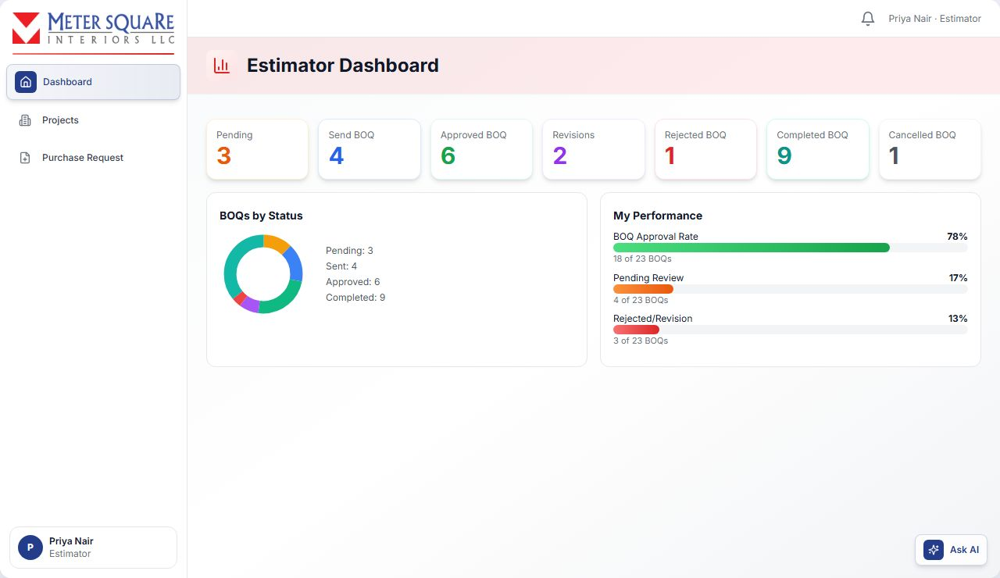

## Projects & BOQ Management

Open **Projects** in the sidebar.

- Search by title, project, client or project code (for example MSQ26).
- Switch between **Cards** and **Table** view.
- Click **New Project** to create a project.

### Tabs

| Tab | What it shows |
|---|---|
| Pending | Projects with no BOQ yet, or with a BOQ still in Draft |
| Send BOQ | BOQs sent for review (to the TD, or to a PM) and waiting for a decision |
| Approved BOQ | BOQs approved by the TD, sent to the client, or confirmed by the client |
| Revisions | Client revisions (R1, R2…) and internal revisions after a TD rejection. Sub-tabs: **Client Revisions** and **Internal Revisions** |
| Rejected BOQ | BOQs rejected by the TD or by a PM. A TD-rejected BOQ you edited but did not re-send also stays here. |
| Completed BOQ | Projects the PM has completed |
| Cancelled BOQ | BOQs cancelled because the client did not proceed |

## How to create a project

1. In **Projects**, click **New Project**. The **Create New Project** form opens.
2. Fill in:
   - **Project Name**, **Client**, **Location**
   - **Work Type** (for example Construction or Renovation)
   - **Working Hours** (for example 8 hours/day), **Floor Name**, **Area** (for example 1000 sq.ft.)
   - **Start Date** (today or later) and **Number of Days**. The **End Date** is calculated automatically.
   - **Description** (optional)
3. Click **Create Project**.

The project gets a code (MSQ01, MSQ02…) and appears in the **Pending** tab. A project name must be unique.

- **To edit**: use **Edit Project** on the card, then **Update Project**.
- **To delete**: use the bin icon and confirm **Delete Project**.

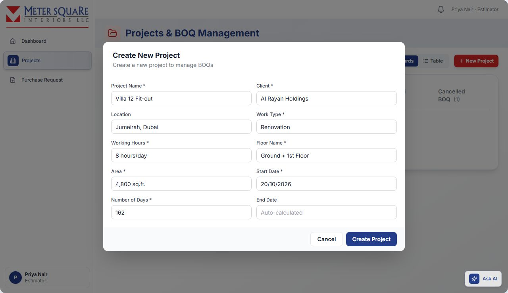

### Project card (Pending tab)

The card shows the project name, code, client, location, number of BOQ items, work type, site engineer and created date. Buttons:

- **View Details**: project information and its related BOQs.
- **Create BOQ** (or **Resume Draft** if you have unsaved work in progress).
- **Send to TD** / **Send to PM**: appear once a BOQ exists and has not been sent.
- **BOQ Created** / **BOQ Sent**: shown greyed out once done.

## How to create a BOQ

1. On the project card, click **Create BOQ**. The full-screen BOQ form opens. Your work is auto-saved in the browser as you go ("Last saved: <time>").
2. **BOQ Details**: enter the **BOQ Name**. The project is filled in automatically.
3. **Preliminaries & Approval Works**: tick the conditions that apply. Click **Add Custom Item** to add your own; custom items are saved to the master list for future BOQs. Fill in the cost details: quantity, unit and rate for the client amount, and the internal cost with Misc %, O&P % and Transport %.
4. **BOQ Items**: click **Add Item**.
   - Type the item name. Pick from **Master Items** or the **Buyer Catalog**, or add a new item. Duplicate items are not allowed.
   - Expand the item and click **Add Sub Item**.
   - For each sub-item, enter **Sub Item Name**, **Scope**, optional **Size**, **Location**, **Brand** and **Images**, then **Quantity**, **Unit** and **Rate**. The total is calculated.
5. **Raw Materials** (internal cost, per sub-item): click **Add Material**. Search the Raw Materials Catalog, Buyer Catalog or Master Materials, or type a new material. Enter **Qty** and **Rate (AED)**. A new material needs Brand, Size and Specification.
6. **Labour** (internal cost): click **Add Labour**. Choose the labour role, work type (Piece Rate, Contract or Daily Wages), **Hours** and **Rate/hr (AED)**.
7. **Cost Breakdown Percentages**: Misc %, Overhead & Profit % and Transport % (defaults 10%, 25%, 5%). The **Profit Analysis** shows client amount, internal cost, planned profit and negotiable margin.
8. **Total Project Value**: review Items Subtotal, Preliminary Amount and Combined Subtotal. Optionally enter an **Overall Discount** (%). The suggested safe discount is shown, and a warning appears if the profit margin drops below 15%. The **Grand Total** excludes VAT.
9. **Terms & Conditions**: tick the terms that apply, or **Add Custom Item**.
10. Click **Create BOQ**. It is enabled once there is a BOQ name and at least one item.

The BOQ is saved as **Draft**.

Each item needs at least one material or labour line, and every rate and quantity must be filled in. The form tells you exactly what is missing.

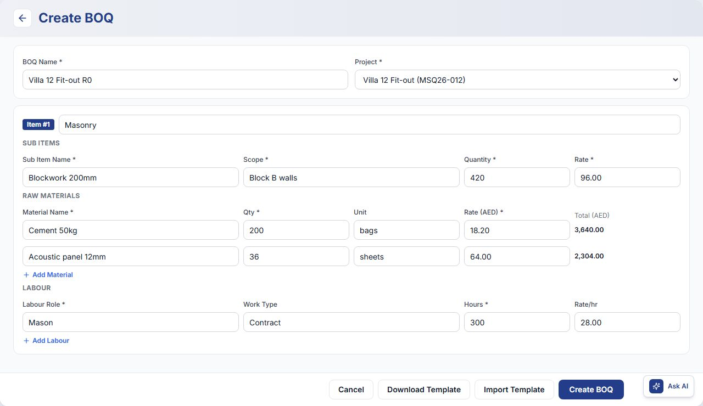

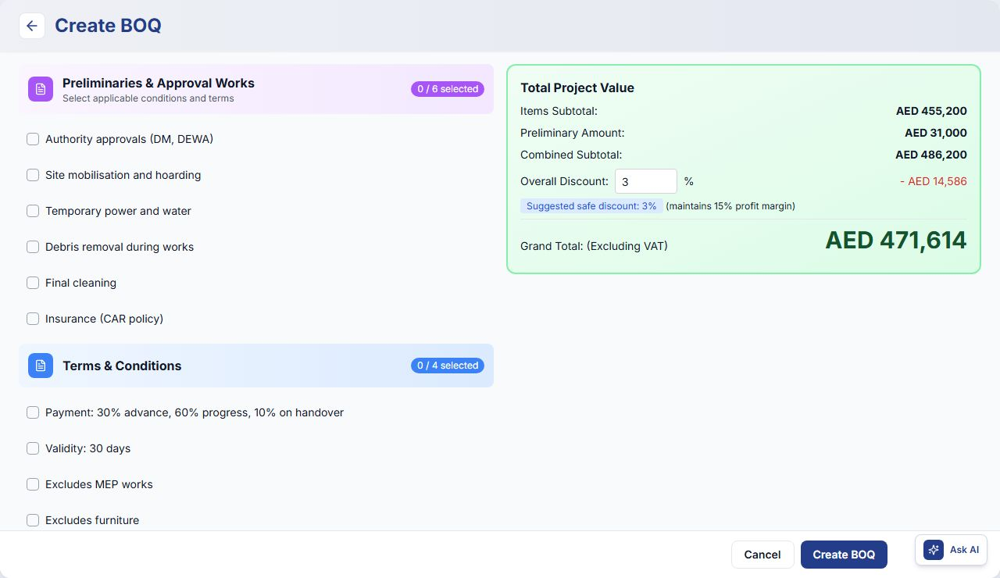

### How to import a BOQ from Excel

When you create a BOQ, the bottom of the form also shows **Download Template** and **Import Template**. These buttons are not shown when you edit a BOQ.

1. Click **Download Template** to get the Excel template.
2. Fill in the items in the template.
3. In the form, enter the **BOQ Name** first.
4. Click **Import Template** and choose the file (.xlsx or .xls, up to 10 MB).

The BOQ is created from the file and saved as **Draft**. Any warnings about the file are shown on screen.

### Leaving the form

- If you close the form, choose **Save as Draft** (recommended) or **Discard Changes**. Uploaded images cannot be kept in a draft.
- After 2 hours idle you are asked to **Continue Working** or close (your draft is kept).
- When you reopen, choose **Restore Previous Work** or **Start Fresh**.

### Editing or deleting a BOQ

- **Edit** (pencil icon) is available when the BOQ is in Draft, Sent for Confirmation, Under Revision or Pending Revision.
- **Delete** (bin icon) is available on a Draft BOQ, until it is sent.
- Cards with status **Internal Revision Pending**, **Client Pending Revision** or **Client Revision Rejected** also show **Edit**, **Delete** and **Send to TD**.

## How to send a BOQ to the Technical Director

- **From the Pending tab**: click **Send to TD** on the project card. All BOQs of that project are sent.
- **From a Draft BOQ card**: click **Send to TD**.

The BOQ moves to **Send BOQ** with status **Pending**, and the TD is notified.

While the BOQ waits for the TD, the card shows a label instead of buttons:

- **Pending TD Approval**: sent to the TD after a PM approval.
- **Revision Pending TD Approval**: an internal revision sent to the TD.

## How to send a BOQ to a Project Manager for review (optional)

You can ask a PM to review the BOQ before it goes to the TD.

1. On the project card, click **Send to PM**.
2. Select a PM and click **Send to PM**. The status becomes **Pending PM Approval** and the PM is notified.
3. **If the PM approves**: the status becomes **PM Approved** (Approved BOQ tab). Click **Send to TD** to send it for final approval.
4. **If the PM rejects**: the status becomes **PM Rejected** (Rejected BOQ tab) with the reason. Edit the BOQ, then click **Resend PM**.

Sending to a PM for review does not assign that PM to the project.

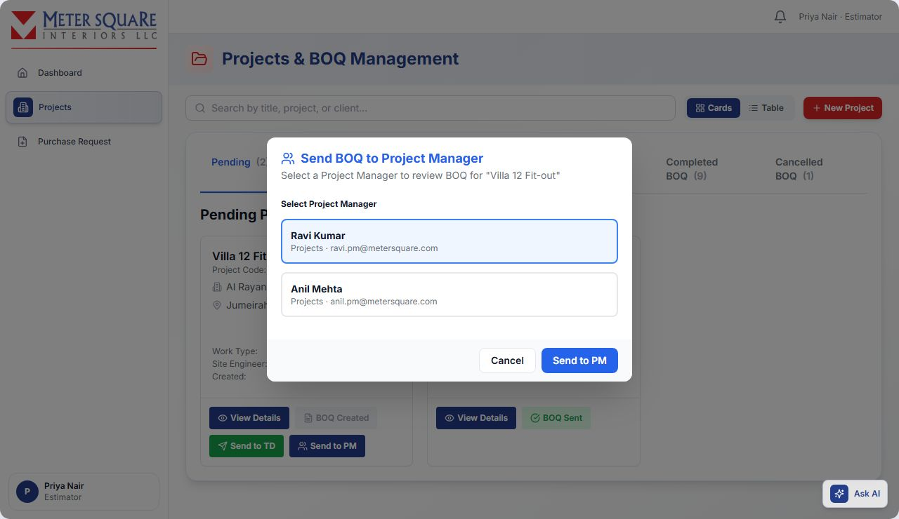

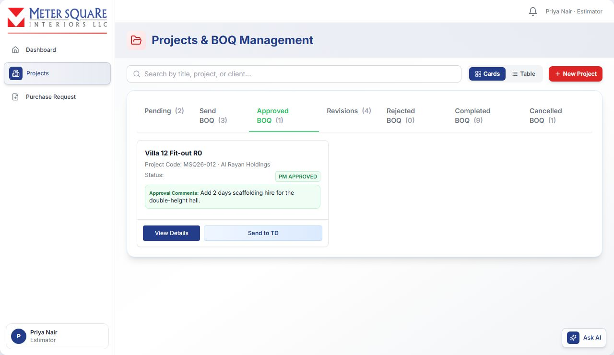

## When the TD approves or rejects

- **Approved**: the BOQ moves to **Approved BOQ** and the TD's comments appear under "Approval Comments". You can now send it to the client.
- **Rejected**: the BOQ moves to **Rejected BOQ** with the "Rejection Reason". If a PM forwarded it, the PM is notified too.

## How to fix a BOQ the TD rejected (internal revision)

1. In **Rejected BOQ**, click **Edit BOQ** on the card.
2. Make the changes and click **Update BOQ**.
3. When asked "Would you like to send this BOQ to the Technical Director for approval now?":
   - **Send to Technical Director**: the status becomes **Pending Revision**.
   - **Send Later**: the status becomes **Internal Revision Pending** and it stays in **Rejected BOQ**. The card shows **Edit BOQ** and **Send to TD**. When you are ready, click **Send to TD** on the card.
4. Track it under **Revisions** → **Internal Revisions**. Select the project to compare the current version with earlier versions, starting from the Original BOQ.

The TD reviews the revision in **Revisions** → **Internal Revisions**.

- **If the TD approves**: the status becomes **Internal Revision Approved**. The card shows **Send to Client**.
- **If the TD rejects**: the status goes back to **Internal Revision Pending** and the BOQ returns to **Rejected BOQ**. Edit it and send it again.

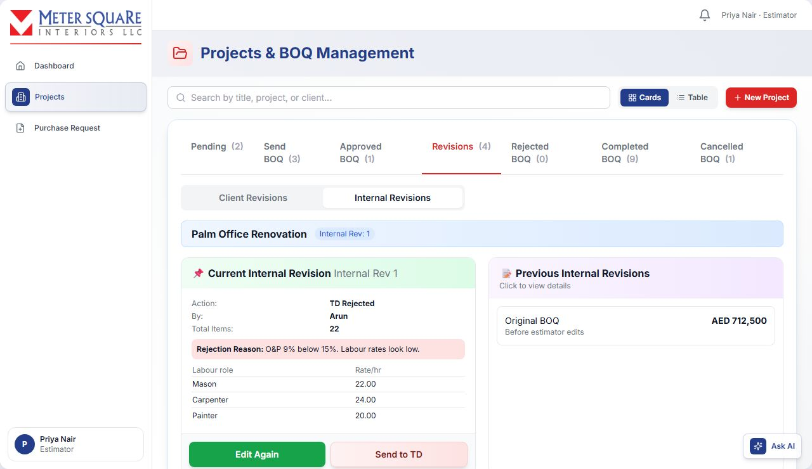

## How to send a BOQ to the client

1. On an approved BOQ card in **Approved BOQ**, click **Send to Client**. For an approved client revision you can also use **Send Revision to Client** in **Revisions** → **Client Revisions**.
2. Enter the **Client Email(s)**. You can enter several, separated by commas, semicolons or new lines.
3. Optional: add an **Additional Message**.
4. Optional: open **Customize Email & PDF Content** to edit:
   - the email body;
   - the PDF cover page (reference number, date, recipient, company, subject, project reference, letter text, contact person, signatory);
   - **Include Authorized Signature**. Leave it unticked if the client will sign manually.
5. Choose the formats: **Excel (.xlsx)** and/or **PDF (.pdf)**.
6. Optional: use **Preview Email**, **Preview PDF**, **Download Excel** or **Download PDF** to check before sending.
7. Click **Send to Client**.

The status becomes **Sent for Confirmation**, the client email is saved on the project, and the TDs are notified that the BOQ was sent to the client.

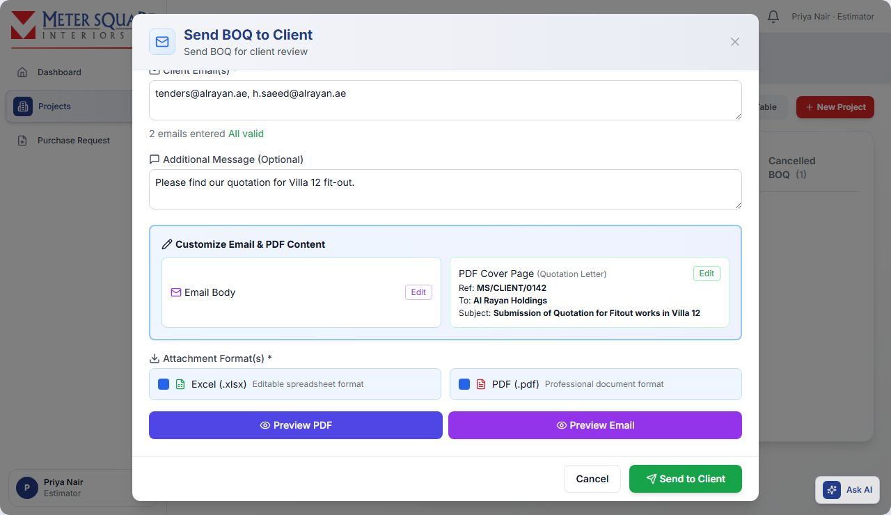

## How to record the client's answer

When the BOQ is **Sent for Confirmation**, the card shows three buttons. These are the only ways to record the client's answer:

- **Client Approved**: the client accepted. The status becomes **Client Confirmed** and the TDs are notified. Next, the TD assigns a Project Manager.
- **Revisions**: the client wants changes. Choose **Make Revision** (or **Cancel Project**, or **Go Back**). See the next section.
- **Cancel**: the client does not want to proceed. See "How to cancel a BOQ".

There is no separate button to mark the BOQ as rejected by the client. Use **Revisions** if the client wants changes, or **Cancel** if the client does not proceed.

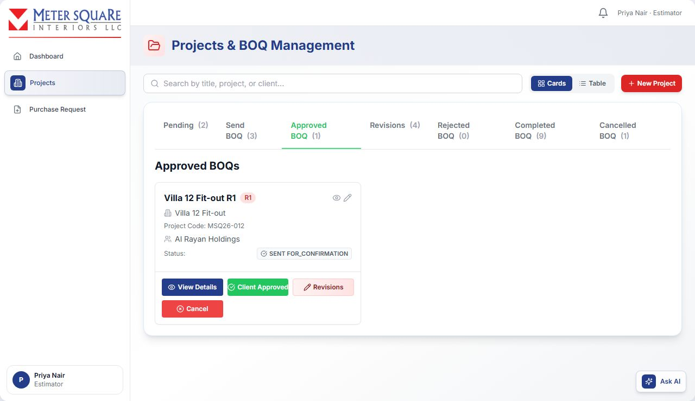

## How to make a client revision

1. Click **Revisions** → **Make Revision**.
2. Edit the BOQ and click **Update BOQ**. The revision number goes up (R1, R2…) and the status becomes **Under Revision**. It now appears in **Revisions** → **Client Revisions**.
3. Use **Edit Again** if needed, then **Send to TD**. The TD is notified.
4. **If the TD approves**: the status becomes **Approved**. On the card in **Approved BOQ**, click **Send to Client**. In **Revisions** → **Client Revisions** the same button reads **Send Revision to Client**. Send it as before.
5. **If the TD rejects the revision**: the status becomes **Client Revision Rejected**. Use **Revise BOQ** and send it again, or **Cancel**.

In **Revisions** → **Client Revisions**, select a project to compare the current revision with previous ones. Revised BOQs also show a **Compare** button.

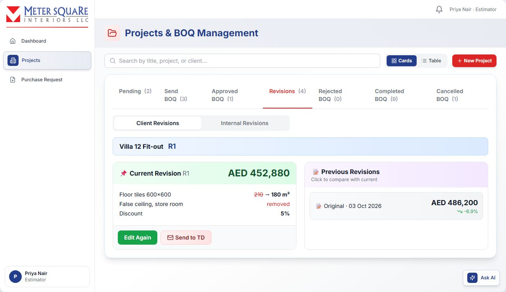

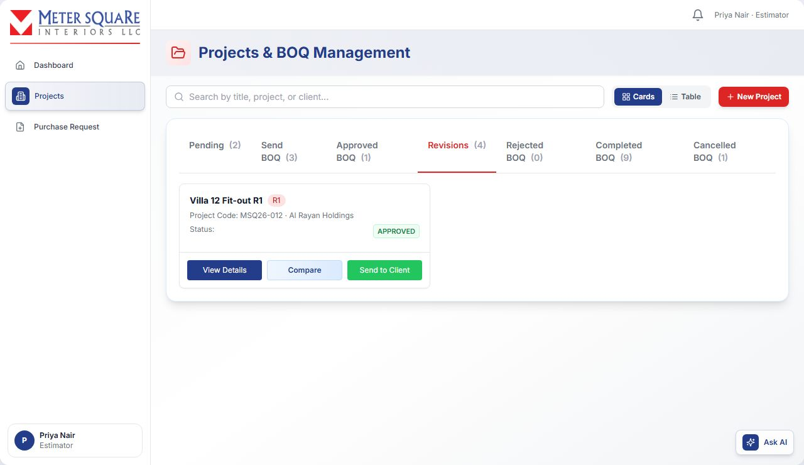

## How to cancel a BOQ (client does not proceed)

1. Click **Cancel**, or **Revisions** → **Cancel Project**.
2. Enter the **Cancellation Reason**.
3. Click **Confirm Cancellation**.

The status becomes **Client Cancelled**. The BOQ moves to **Cancelled BOQ** and shows "Project Permanently Cancelled". **Cancel** is not shown on completed BOQs.

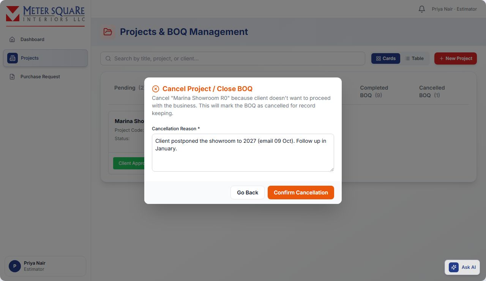

## After the client approves

- The **Technical Director** assigns a Project Manager to the project. This is only possible after the client has approved.
- The PM then assigns BOQ items to Site Engineers. The card shows "Items Assigned to SE".
- When the PM confirms the project is complete, the BOQ moves to **Completed BOQ**.

## Viewing and downloading a BOQ

Click **View Details** (eye icon) to open the full BOQ.

- **Tabs**: BOQ Details, History & Timeline, and Client Revisions (when the BOQ has revisions).
- **Download**:
  - **Internal BOQ**: includes overheads, profit margins and the detailed breakdown.
  - **Client BOQ**: final prices only.
  - Then choose **Download Excel** or **Download PDF**.

## BOQ statuses

| Status | Meaning | Tab |
|---|---|---|
| Draft | Created, not yet sent | Pending |
| Pending | Sent to the TD, waiting for a decision | Send BOQ |
| Pending PM Approval | Sent to a PM for review | Send BOQ |
| PM Approved | PM approved. Send it to the TD. | Approved BOQ |
| PM Rejected | PM rejected. Edit and resend to the PM. | Rejected BOQ |
| Pending TD Approval | Sent to the TD after PM approval | Send BOQ |
| Approved | TD approved the BOQ or a client revision. Ready to send to the client. | Approved BOQ |
| Rejected | TD rejected | Rejected BOQ |
| Internal Revision Pending | A TD-rejected BOQ was edited but not yet re-sent, or the TD rejected the internal revision | Rejected BOQ |
| Pending Revision | Internal revision sent to the TD | Revisions |
| Internal Revision Approved | TD approved the internal revision. Ready for the client. | Approved BOQ |
| Under Revision | Client revision being prepared | Revisions |
| Client Pending Revision | Client revision sent to the TD | Revisions |
| Client Revision Rejected | TD rejected the client revision | Revisions |
| Sent for Confirmation | Emailed to the client, waiting for an answer | Approved BOQ |
| Client Confirmed | Client approved. TD will assign a PM. | Approved BOQ |
| Client Cancelled | Client did not proceed | Cancelled BOQ |
| Items Assigned | PM assigned items to Site Engineers | Approved BOQ |
| Completed | Project completed | Completed BOQ |

## Purchase Requests (material requests needing pricing)

Open **Purchase Request** in the sidebar. These are requests for extra materials on approved projects, raised by Site Engineers or Project Managers.

- A request comes to the Estimator when the PM approves it and:
  - it contains **new materials** that are not in the BOQ. Materials picked **From Catalogue** count as new; or
  - a BOQ material's quantity is already used up or exceeded by earlier requests; or
  - the PM chooses to send it to the Estimator.
- Other requests go straight to Procurement.
- **Tabs**:
  - **Pending**: waiting for you.
  - **Approved**: sent to a buyer or further in the process.
  - **Completed**: purchase completed or routed to the store.
  - **Rejected**.
- Each card shows the request number (PO-…), project area, requester, date, number of materials and total cost.

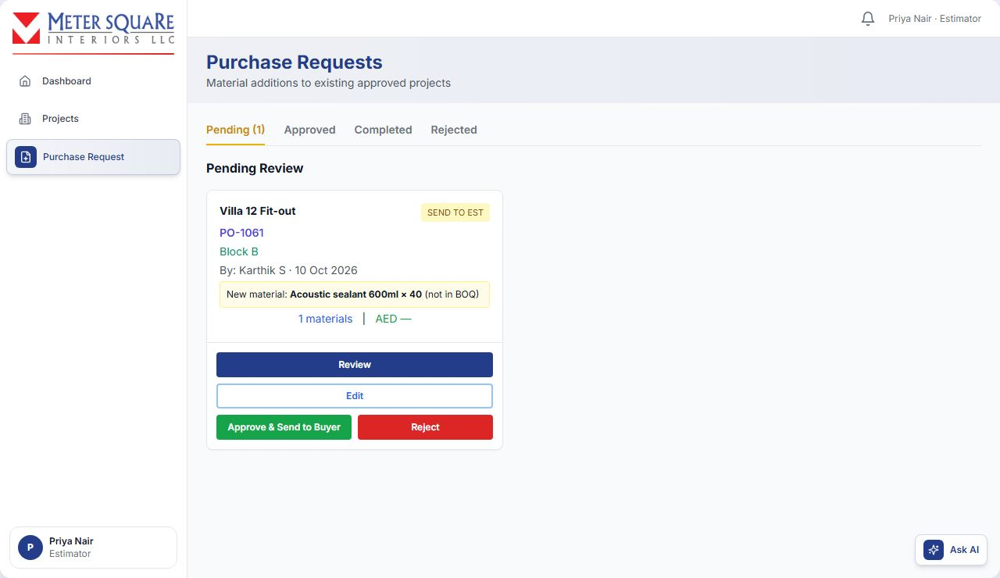

### How to approve a purchase request and assign a buyer

1. Click **Review** to see the materials. You can edit prices there. Use **Edit** to change the request.
2. Click **Approve & Send to Buyer**.
3. Under **Assign to Procurement**, choose a buyer. Buyers are grouped **Online** and **Offline**; an offline buyer gets an email. People with temporary Procurement access show a **Granted · until <date>** tag.
4. Optional: add **Comments**.
5. Click **Approve & Assign**.

The request goes to that buyer for purchase, the materials are added to the BOQ, and the buyer is notified.

### How to reject a purchase request

1. Click **Reject**.
2. Enter a reason and confirm.

The requester is notified with the reason.
