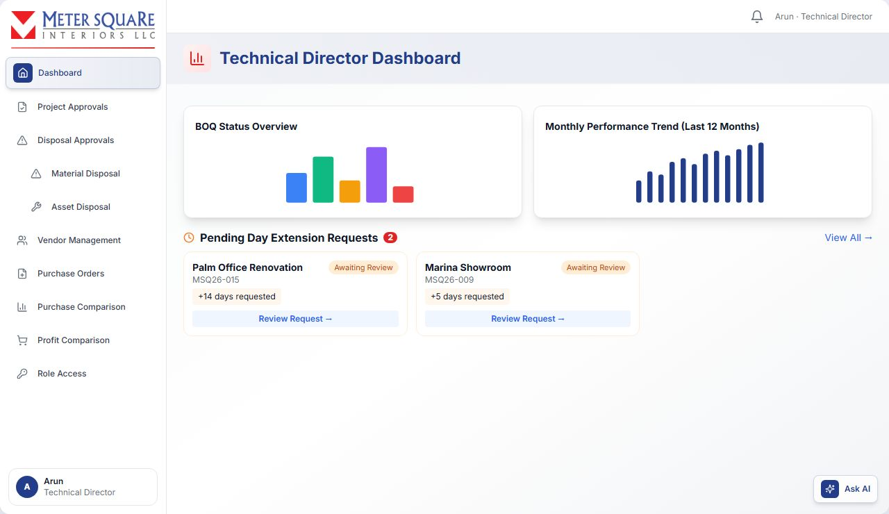
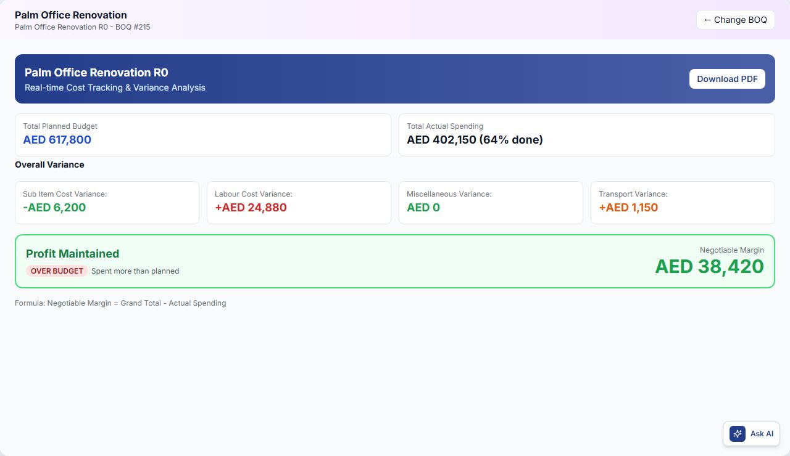

# Technical Director

The Technical Director (TD) is the main approver.

- Approves BOQs.
- Assigns Project Managers and MEP Supervisors to projects.
- Approves day extensions, vendor selections and vendor return requests.
- Approves material and asset disposals.
- Can grant temporary role access to other users.

TD menu: **Dashboard**, **Project Approvals**, **Disposal Approvals** (Material Disposal, Asset Disposal), **Vendor Management**, **Purchase Orders** (All Orders, Return Approvals), **Purchase Comparison**, **Profit Comparison**, **Role Access**.

Whenever the TD acts, the person affected gets an in-app notification, and an email only if they are offline.

## Technical Director Dashboard

The dashboard shows:

- **BOQ charts**: BOQ Status Overview, BOQ Status Distribution, Budget Distribution, Top 5 Projects by Budget.
- **Trends**: monthly performance, revenue and disposal requests.
- **Pending Day Extension Requests**: click **Review Request** to open Project Approvals.
- **Active Projects Overview**: each project with its Project Manager, progress, budget used, due date, and whether it is on track or delayed.

## Project Approvals

Open **Project Approvals**. Search by BOQ ID (B-123), project code (MSQ26), project name or client. Switch between card and table view.

### Tabs

| Tab | What it shows |
|---|---|
| Pending | New BOQs waiting for your approval |
| Approved | BOQs you approved, including those sent to the client |
| Client Response | BOQs the client confirmed, waiting for a Project Manager |
| Revisions | Client and internal revisions to review. Internal revisions the Estimator sends back after your rejection appear here under **Internal Revisions**, not in Pending. |
| Assigned | Projects with a Project Manager assigned |
| Completed | Completed projects |
| Rejected by TD | BOQs you rejected |
| Cancelled | BOQs the client cancelled |

Each card shows:

- the project, client, dates and duration;
- the Total Value, Items, Labor Cost, Material Cost and O&P margin;
- any approval, rejection or cancellation remarks.

### How to approve a BOQ

1. In **Pending**, click the eye icon (**View BOQ Details**). The full BOQ opens.

2. Review it and click **Approve**.

3. Optional: add **Approval Notes**, then click **Approve Project**.

4. A comparison opens: the internal version (with costs and margins) next to what the client will receive. Check it and click **Approve**.

The BOQ becomes **Approved**. The Estimator is notified and then sends it to the client.

### How to reject a BOQ

1. Open the BOQ and click **Reject**.

2. Enter the reason. It is required and goes to the Estimator for corrections.

3. Click **Reject Project**.

The BOQ becomes **Rejected**. The Estimator, and the PM if one forwarded it, are notified.

### How to review revisions

1. Open the **Revisions** tab and select a project.
2. Compare the revisions under **Client Revisions** or **Internal Revisions**.

3. Click **Approve** or **Reject** (rejecting needs a reason).

| Revision | If you approve | If you reject |
|---|---|---|
| Internal revision | **Internal Revision Approved**. The Estimator can send it to the client. | **Internal Revision Pending**. It goes back to the Estimator to fix. |
| Client revision | **Approved**. The Estimator can send it to the client. | **Client Revision Rejected** |

An approved revision shows **Approved - Ready for Client**.

### How to download a BOQ

1. In the BOQ view, click **Download**.

2. Choose the **Internal** version or the **Client** version (without overhead and profit).
3. Choose **Excel** (multiple sheets) or **PDF**.

### How to assign a Project Manager and MEP Supervisor

You can assign a PM only after the client has approved the BOQ. The card then shows **Assign PM**.

1. Click **Assign PM**.

2. Choose **Select Existing PM**.
   - Search for a PM. PMs are grouped Online and Offline, and each shows a workload badge: **Available** (0 projects), **Busy** (1–3) or **Overloaded** (more than 3), plus their current projects.
   - You can select more than one PM.
   - People with temporary Project Manager access show a **Granted · until <date>** tag.

3. Optional: in **Assign MEP Supervisor**, all MEP Supervisors are ticked by default. Untick the ones you do not want, or click **Clear**.

4. Click **Assign N PM(s) to Project**.

The project moves to **Assigned** and the PM is notified with the project details. The PM now manages the project, its Site Engineers and its purchasing.

### How to create a new PM while assigning

1. In the assign window, choose **Create New PM**.
2. Enter **Full Name**, **Email Address** and **Phone Number**.

3. Click **Create & Assign**.

In this mode no MEP Supervisor is assigned. Assign MEPs separately if needed.

### How to delete a Project Manager

Click the bin icon next to the PM in the assign window and confirm. A PM who is assigned to any project cannot be deleted.

### How to handle a day extension request

A Project Manager or MEP Supervisor can ask for more days on a project. Assigned projects with pending requests show a blinking clock badge.

1. Click the clock badge on the project card.
2. Review the request: who asked, the current duration and end date, the additional days, the new end date and the reason.

3. Choose an action:
   - **Approve**: the project's duration and end date are extended.
   - **Edit**: enter a different number in **Edit Extension Days** and an optional reason, then click **Save Changes**. The request shows "Edited by TD". You must still **Approve** or **Reject** it.
   - **Reject**: enter the **Reason for Rejection** and click **Reject**.

The requester is notified.

## Purchase Orders: approving vendor selections

When Procurement chooses a vendor for a material purchase request, the TD must approve that vendor. Open **Purchase Orders** → **All Orders**.

- **Tabs**: **Vendor Approvals** and **Completed**.
- **Vendor Approvals sub-tabs**:
  - **Pending**: waiting for you.
  - **Approved**: buyers can complete the purchase.
  - **Rejected**: buyers must choose a new vendor.
- A purchase split across several vendors shows one entry per vendor, numbered for example PO-123.1 and PO-123.2.

### How to approve or reject a vendor selection

1. In **Pending**, click **Details** to see the vendor, materials and total cost.

2. To approve, click **Approve Request**.
   - The status becomes **Vendor Approved**.
   - The purchase order (LPO) PDF is generated automatically.
   - The buyer is notified and can complete the purchase.

3. To reject, click **Reject**, enter the reason and click **Submit Rejection**. The vendor is cleared and the buyer must choose another vendor.

On approved items, click **View LPO** to see the purchase order details. An approved LPO cannot be edited.

## Purchase Orders: Return Approvals

When delivered material is rejected, the buyer raises a **vendor return request (VRR)**. Open **Purchase Orders** → **Return Approvals**.

- **Tabs**: **Pending Return Approvals**, **New Vendor Approvals**, **History** (All, Approved, Rejected, In Progress, Completed).
- Search by VRR number, CR ID, vendor or buyer.
- Each request shows the buyer, vendor, resolution (**Refund**, **Replacement** or **New Vendor**), status, total value and date.

### How to approve or reject a return request

1. Expand the request. Review the buyer notes, deadline, inspection details, rejected materials and any credit note.

2. Click **Approve Return Request**. When the resolution is a new vendor, the button reads **Approve Return & New Vendor**.

3. Or click **Reject** and enter the reason.

In **New Vendor Approvals**, review the new vendor's details and the vendor it replaces, then click **Approve Vendor** or **Reject Vendor**.

**Return statuses**: Pending Your Approval, Approved, Rejected, New Vendor Pending, New Vendor Pending Approval, New Vendor Approved, Return In Progress, Returned to Vendor, Awaiting PM Inspection, Completed.

## Disposal Approvals

### Material Disposal

Open **Disposal Approvals** → **Material Disposal**. The tabs are **Pending**, **Approved** and **Rejected**. Search by material name, code or requester.

1. Click **View Details**. Review the material, current stock, quantity to dispose, estimated value, reason and justification.

2. Enter **Your Review Notes**. Notes are optional to approve and required to reject.

3. Choose:
   - **Approve Disposal**, then **Yes, Approve Disposal**. The quantity is permanently removed from inventory.
   - **Reject & Add to Backup**. The quantity is added to backup stock for repair or reuse.

### Asset Disposal

Open **Disposal Approvals** → **Asset Disposal**. The tiles show Pending, Approved, Rejected and Pending Value.

1. Open the request. Review the asset, serial number, reason, justification and the evidence photo (click it to enlarge).

2. Choose:
   - **Approve Disposal**, then **Yes, Approve Disposal**. The asset quantity is reduced.
   - **Reject Disposal**. Choose **Return to Stock** or **Send to Repair** and enter review notes (required).

## Vendor Management

Open **Vendor Management** to view and manage vendors. This is the same page Procurement uses: see **Procurement → Vendors**. Vendors are marked **Active** or **Inactive**.

The TD approves vendors for each purchase through **Purchase Orders**, not on this page.

## Purchase Comparison

Compare planned budget with actual spending.

1. Open **Purchase Comparison** and choose **Live Projects** or **Completed**.

2. Find the project and click **View Comparison**.
3. Each item shows **Planned Budget** next to **Actual Spending**, with a badge: Over Budget, Under Budget, On Budget, Not Purchased or Unplanned.
4. The totals show Total Planned, Total Actual (incl. VAT) and the Balance.

5. Export with **Excel** or **PDF**.

## Profit Comparison

Open **Profit Comparison** to compare the original BOQ with actual purchases.

- **Live Projects** / **Completed**: click **View Comparison** on a project.
- **Report**: select a project and click **View Report**. The detailed profit report can be filtered by **Transport**, **Material** and **Labour**.

## Role Access

The TD can give users temporary access to another role, the same as the Admin. In the TD sidebar, click **Role Access** (it is a menu item of its own, not under another menu). The screen and its steps are the same as the Admin's; the full steps are in the Admin chapter, section "Role Access".

The **Role Access** menu is hidden while you are working in a granted role yourself. Click **Switch back to Technical Director** in the amber banner to see it again.
