# Project Manager and MEP Supervisor

The Project Manager (PM) runs the projects the Technical Director assigned to them:

- assigns Site Engineers and BOQ items;
- approves material purchase requests from site;
- approves asset and labour requests;
- locks attendance for payroll;
- confirms project completion.

The **MEP Supervisor** uses the same screens for the projects where they are assigned as MEP. Everything in this chapter applies to both unless stated.

PM and MEP menu: **Dashboard**, **My Projects**, **Material Purchase**, **Asset Requisition Approvals**, **Labour** (Requisition Approvals, Attendance Lock).

When you act, the person affected gets an in-app notification, and an email only if they are offline.

## Dashboard

The **Project Manager Dashboard** (MEP: **MEP Supervisor Dashboard**) shows:

- **Tiles**: Total BOQ Items, Items Assigned, Pending Assignment, Assets Approved, Labour Pending, Labour Approved, Attendance Locked and POs Completed.
- **Charts**: BOQ Status, Labour & Attendance (PM only), Purchase Orders and Asset Requisitions.
- **Recent SE Requests**: the latest requests from your Site Engineers.

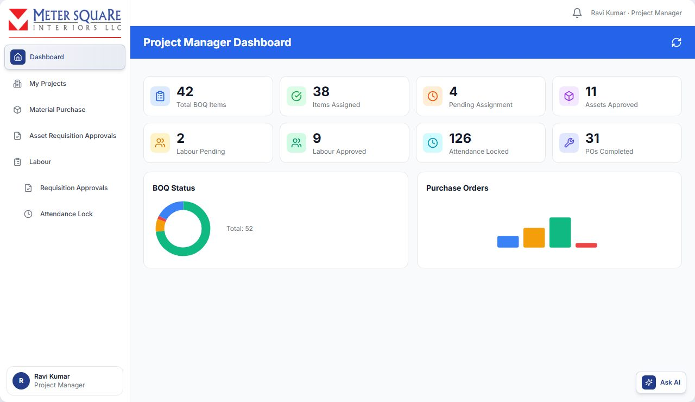

## My Projects

Open **My Projects**. Search by project, client or location. Switch between card and table view.

### Tabs

| Tab | What it shows |
|---|---|
| For Approval | BOQs the Estimator sent to you for review |
| Pending | Approved projects whose BOQ items are not all assigned yet |
| Assigned | Projects with items assigned to Site Engineers |
| Approved | BOQs you approved |
| Rejected | BOQs you rejected |
| Completed | Completed projects |

Each card shows:

- the project, client and Site Engineer;
- the location, status, start and end date (marked **Extended** after an approved extension);
- the items assigned or still pending.

### How to review a BOQ the Estimator sent you

1. In **For Approval**, click the eye icon (**View Details**).
2. Choose:
   - **Edit**: change the BOQ in the full BOQ editor and save.
   - **Approve**: add optional comments and confirm. The BOQ goes back to the Estimator as **PM Approved**, ready to send to the TD.
   - **Reject**: enter the reason. The BOQ goes back to the Estimator as **PM Rejected**.

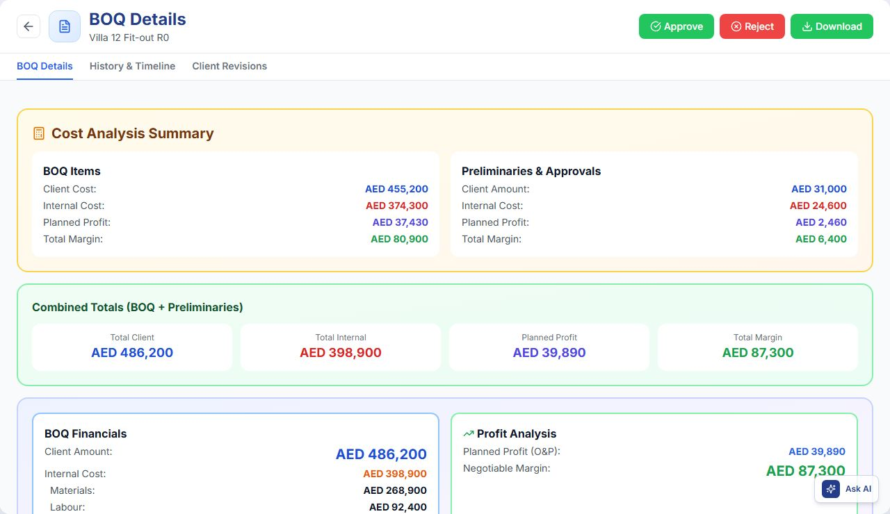

### How to assign BOQ items to a Site Engineer

In **card view**:

1. On the project card, click **Assign Items to Site Engineer**. It is greyed out when all items are already assigned.
2. On the left, choose **Select Existing SE** and pick a Site Engineer. Each one shows their current projects.
   - Or choose **Create New SE**: enter Full Name, Email and Phone, then click **Create & Select SE**.
3. On the right, under **Items to Assign**, tick the items. Picking an SE selects all items; untick any you want to give to someone else. Already assigned items are listed under **Assigned Items**.
4. Click **Confirm Assignment**.

In **table view**, a project with no Site Engineer yet shows **Assign Site Engineer**. It assigns one Site Engineer to the whole project. Here, people with temporary Site Engineer access show a **Granted · until <date>** tag.

The Site Engineer is notified, and the project moves to **Assigned**. Each Site Engineer can be assigned to at most **3 projects**.

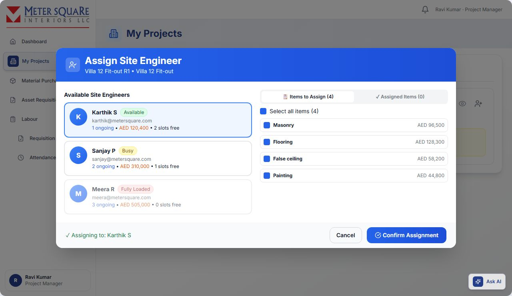

### How to edit or remove a Site Engineer

On the project card, use the icons next to the Site Engineer's name:

- **Edit Site Engineer Details**: change the Full Name, Email or Phone, then click **Save Changes**.
- **Delete Site Engineer**: confirm **Delete**. This removes the user from the system.

### How to confirm project completion

When Site Engineers finish, they request completion.

In **card view**:

1. Click the **x/y confirmations** button on the card. It pulses orange when a Site Engineer has requested completion.
2. The panel lists each Site Engineer assignment with one of: "SE requested completion", "Awaiting SE completion request" or "PM confirmed".
3. Click **Confirm Complete** for each finished assignment.

In **table view**, click **SE Requested Completion - Click to Approve**, then **Confirm Complete** in **Approve Completion Request**.

When everyone has confirmed, the project is marked complete automatically ("Project automatically marked as complete!"). The BOQ appears in the Estimator's **Completed BOQ** tab.

The project does **not** complete while any material purchase in the project is still unfinished or any asset return is still open. You then see "Project will auto-complete when all purchases and returns are finished".

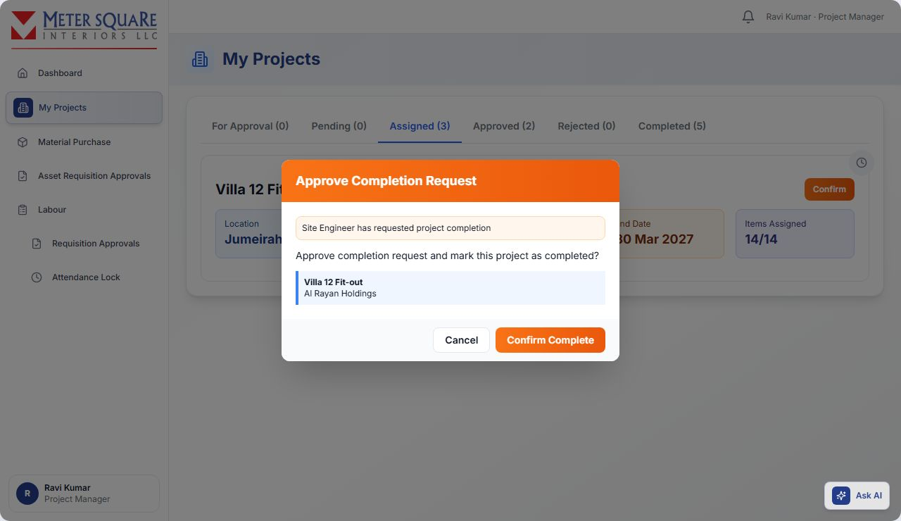

### How to request a day extension

1. Open the BOQ and click **Request Extension**, or click the clock badge on an assigned project card.
2. Enter **Additional Days Requested**. The new end date is previewed.
3. Enter the **Reason for Extension**.
4. Click **Send Request**.

The Technical Director is notified and approves, edits or rejects it. You cannot send another request while one is pending. The request history shows Pending TD Approval, Approved or Rejected.

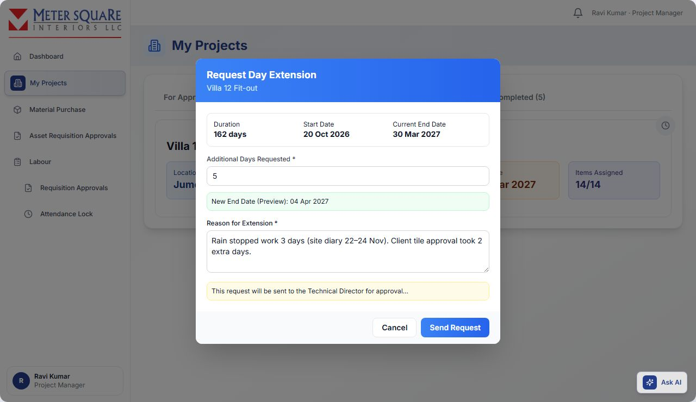

## Material Purchase (change requests)

Site Engineers and PMs request extra materials for an approved project through **Material Purchase**. These requests are also called change requests (CR) or purchase requests (PO-…).

In the Project Manager view, prices are hidden. The MEP Supervisor sees prices.

### How a material purchase request moves

```flow
Site Engineer: Creates the request and clicks Send to PM
Project Manager: Approves (or rejects with a reason)
Estimator: Prices and approves requests that contain new materials, then picks a buyer
Procurement: Selects the vendor
Technical Director: Approves the vendor selection
Procurement: Sends the purchase order and completes the purchase
Production Manager: Receives the delivery at the M2 Store and dispatches it to site
Site Engineer: Confirms delivery on site
```

**Routing rules**:

- If the request contains **new materials** (not in the BOQ), approval sends it to the **Estimator** first. Materials picked **From Catalogue** count as new.
- If **all materials are existing BOQ materials**, approval sends it **directly to a buyer** you choose.
- If an **MEP Supervisor** assigned the item to the Site Engineer, the request goes to that MEP instead of the PM.

### Tabs

| Tab | What it shows |
|---|---|
| SE Requested | Requests from your Site Engineers waiting for your approval |
| My Requests | Your own requests: **Drafts (Not Sent)**, **Sent to Estimator**, **Sent to Buyer** |
| Accepted | Approved requests in progress (with the Estimator, buyer or TD, or sent to the store) |
| Completed | Purchase completed or routed to the M2 Store |
| Rejected | Rejected requests, with the reason and who rejected it |

### How to approve or reject a Site Engineer's request

1. In **SE Requested**, click **Review Details**. Use **Edit** to change quantities or materials if needed.
2. Approve it:
   - **Approve & Send to Estimator** is shown when the request has new materials. The Estimator is notified.
   - **Approve & Send to Buyer** is shown when all materials are existing. Choose the buyer under **Assign to Procurement**. Buyers are grouped Online and Offline; an offline buyer gets an email; people with temporary Procurement access show a **Granted** tag. Add optional comments and click **Approve & Assign**.
3. Or click **Reject**, enter the reason and click **Submit Rejection**. The Site Engineer is notified.

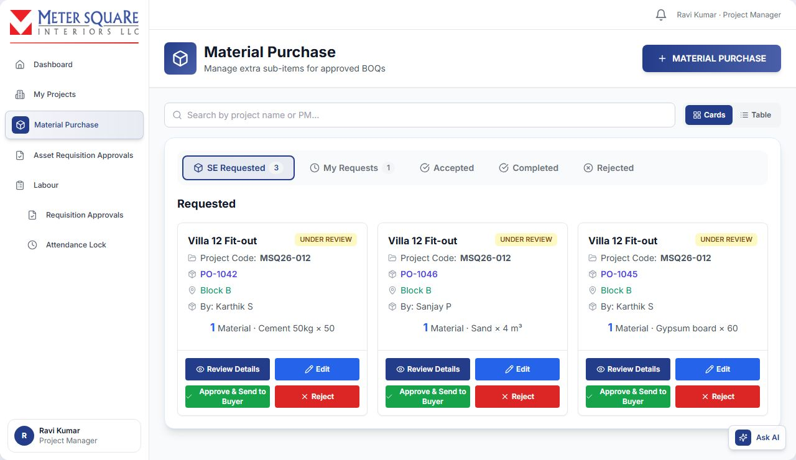

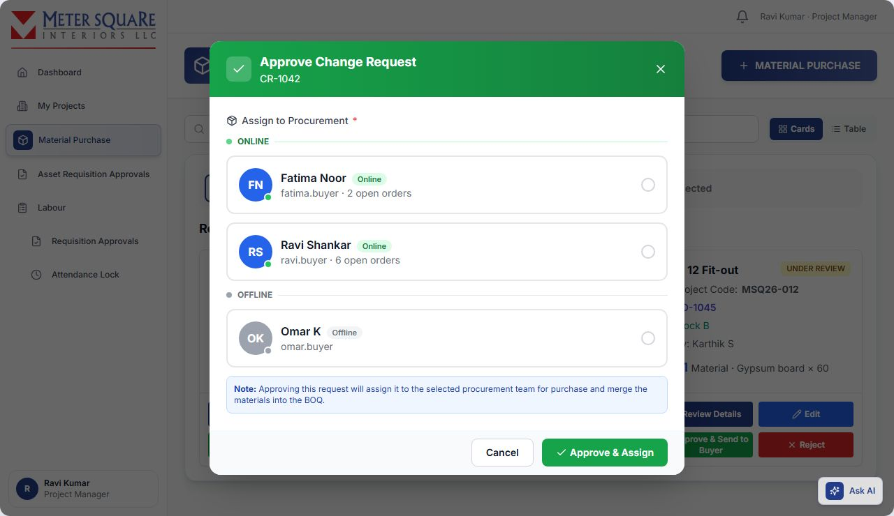

### How to create your own material purchase request

1. Click **MATERIAL PURCHASE**.
2. On the **Materials** tab, select the **Project Name**, **Area**, **BOQ**, **BOQ Item** and **Sub-Items (Scopes)**.
3. For each sub-item, add materials in one of two ways:
   - **Select Material**: pick an existing material from the BOQ.
   - **Add New** for a material not in the BOQ, then choose **From Catalogue** (search by name, brand or category) or **Enter Manually** (name and optional brand, size and specification).

   One request uses one way only. Once a sub-item uses **Select Material**, **Add New** is disabled for the others ("Another sub-item is using … mode"), and the other way round. Put existing and new materials in separate requests.

   Existing BOQ materials are tagged **BOQ**, new ones **NEW**. Fully used materials show "Fully Consumed".
4. Enter the **Request Quantity** and **Unit** for each material. The quantity cannot exceed what is allocated in the BOQ.
5. Write a **Justification** (at least 10 characters):
   - one for each new material;
   - one common justification for the existing materials.
6. Optional: add **Remarks**.
7. Click **Create Purchase Request**. The request is saved as a draft under **My Requests → Drafts (Not Sent)**.

### How to send your draft

In **Drafts (Not Sent)**, click:

- **Send to Estimator** when the request has new materials, or
- **Send to Buyer** when all materials are existing. Choose the buyer and click **Approve & Assign**.

### How to request preliminaries

On the **Preliminaries** tab of **MATERIAL PURCHASE**:

1. Choose from the preliminaries selected in the BOQ.
2. Enter the **Purchase Amount (AED)** and an optional justification and remarks.
3. Click **Create Request**. It is saved as pending and can be sent to a buyer later.

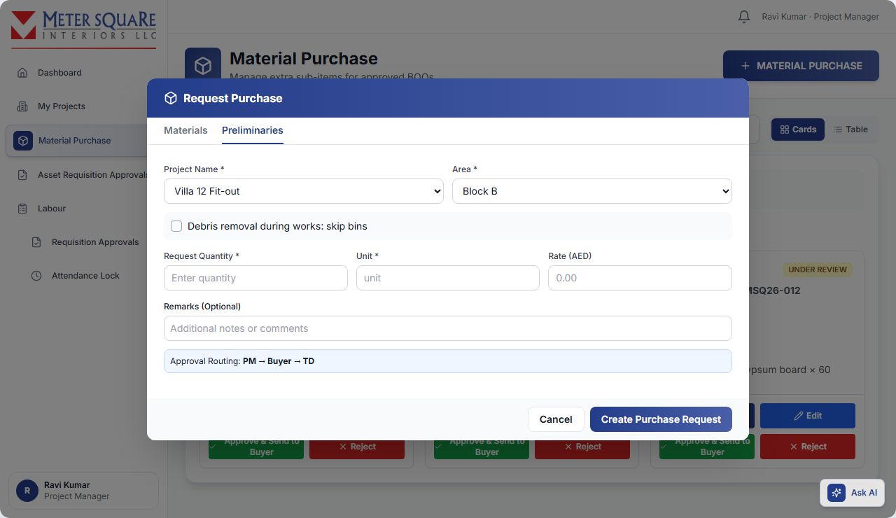

### Change request statuses

| Status shown | Meaning |
|---|---|
| Pending | Created, not yet sent |
| PM Approval Pending | Sent by the Site Engineer, waiting for the PM (or the MEP Supervisor) |
| Estimator Approval Pending | Waiting for the Estimator to price new materials |
| TD Approval Pending | Buyer chose a vendor. Waiting for TD vendor approval. |
| Under Review | Waiting for another approver |
| APPROVED BY PM | Approved by the PM |
| SENT TO ESTIMATOR | Approved by the PM/MEP. New materials need pricing. |
| SENT TO BUYER / ASSIGNED TO BUYER | With a buyer for purchase |
| APPROVED BY TD | Approved by the Technical Director |
| VENDOR APPROVED | TD approved the vendor. Buyer can complete the purchase. |
| ROUTED TO M2 STORE | Purchase completed. Vendor delivers to the M2 Store. |
| PURCHASE COMPLETED | Delivery received at the store and processed |
| REJECTED | Rejected, with the reason shown |

When a buyer splits a purchase across vendors, the request shows a **Split into N Vendors** box with the state of each vendor order (Completed, Vendor Approved or Pending TD).

## Asset Requisition Approvals

Site Engineers request returnable assets (tools and equipment) for site. Open **Asset Requisition Approvals**. The tabs are **Pending**, **Approved** and **Rejected**.

1. Review the request: purpose, required date, site location, assets and urgency.
2. Click **Approve** (optional notes). It goes to the Production Manager for final approval and dispatch.
3. Or click **Reject** and enter the **Rejection Reason**. The Site Engineer can edit and resend it.

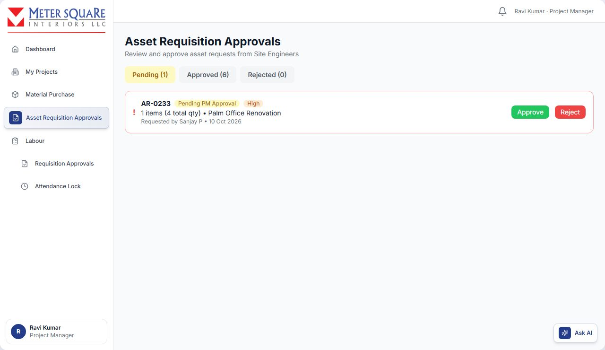

## Labour: Requisition Approvals

Open **Labour** → **Requisition Approvals**. Tabs: **My Pending**, **SE Pending**, **Approved**, **Rejected**.

### How to approve Site Engineer labour requests

1. In **SE Pending**, click **View** to see the labour items, number of workers, dates, shift and preferred workers.
2. Click **Approve**. It goes to the Production Manager to assign workers.
3. Or click **Reject** and enter the reason. The Site Engineer can edit and resend it.

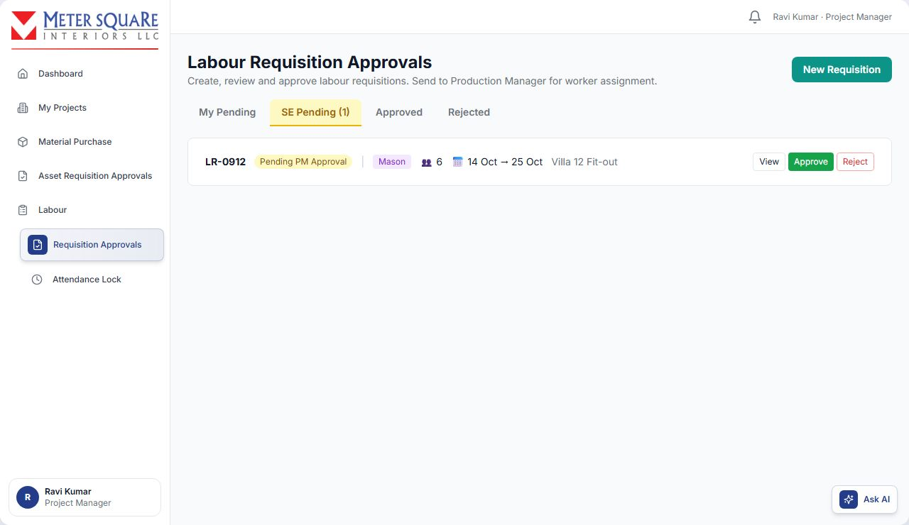

### How to create your own labour requisition

1. Click **New Requisition**.
2. Select the **Project**. The site is filled in automatically.
3. Enter the **Start Date**, **Start Time** and **End Time**. The end date is calculated; for a night shift it becomes the next day.
4. Optional: choose **Preferred Workers**.
5. Choose the labour items from the project's BOQ and set the number of workers for each.
6. Click **Create N Requisition(s)** (N is the number of labour items). One requisition is created holding all the items.
7. In **My Pending**, click **Send to Production**. The Production Manager is notified to assign workers.

## Labour: Attendance Lock

Locked attendance is what goes to payroll. Open **Labour** → **Attendance Lock**.

1. Choose the **Project** (default: All Projects) and, optionally, a **Date**.
2. Review the records in **Pending Lock**: worker, clock in/out, hours, overtime and cost. Click **View** for the full detail (regular and overtime hours, rate, break, overtime multiplier, total cost).
3. Lock the records you have checked:
   - **Lock** on one row, or
   - tick rows and click **Lock Selected**, or
   - **Lock All for Day**, shown once you have chosen both a project and a date.

Locked records move to **Locked** and the Admin is notified for payroll. Only locked attendance appears in **Payroll Processing**.

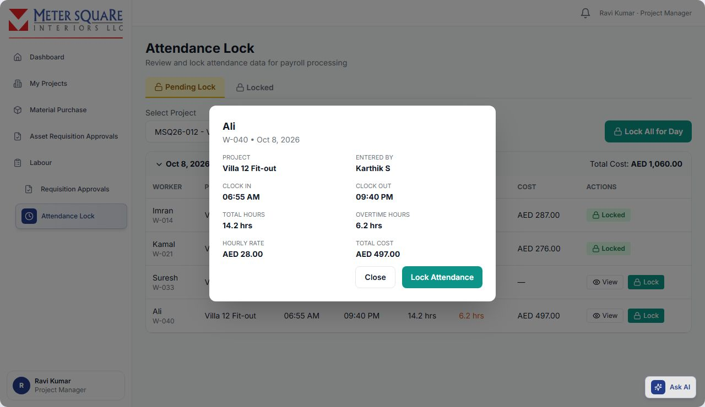

### How hours and cost are calculated

- **Total hours** = clock-out time minus clock-in time, minus breaks.
- **Overtime** = time worked after the requisition's shift end time. If no shift was set, overtime is anything over 8 hours.
- **Cost** = regular hours × rate + overtime hours × rate × 1.5.
