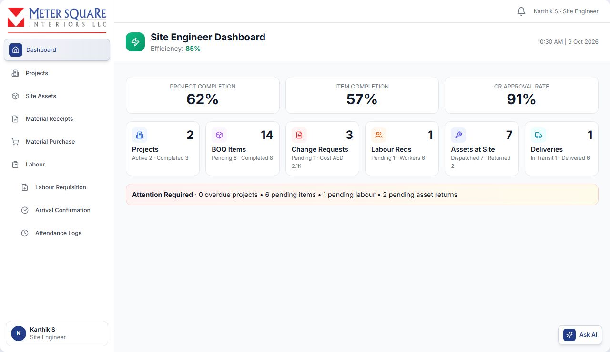
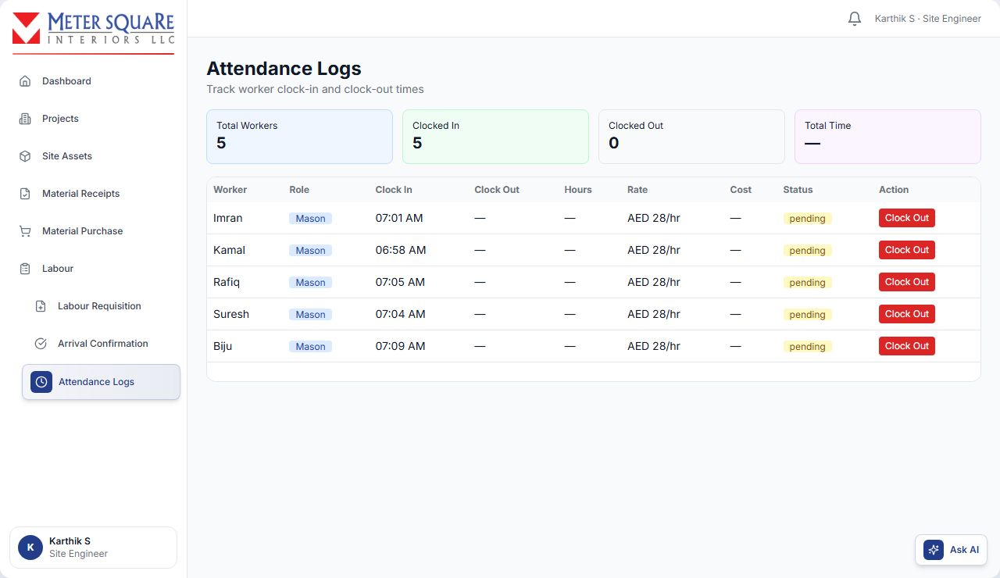

# Site Engineer

The Site Engineer (SE) works on site. They:

- see the BOQ items assigned to them;
- request extra materials;
- confirm deliveries from the M2 Store and return unused materials;
- request and return assets (tools and equipment);
- request labour and record worker attendance;
- ask the PM to mark the project complete.

Site Engineer menu:

- **Dashboard**
- **Projects**
- **Site Assets**
- **Material Receipts**
- **Material Purchase**
- **Labour**: Labour Requisition, Arrival Confirmation, Attendance Logs

You can sign in with your email or, if a phone number is saved on your account, by SMS (choose **Phone (SMS)** at sign-in).

## Site Engineer Dashboard

- **Header**: your efficiency percentage and a period selector (7, 30 or 90 days).
- **Performance**: Project Completion, Item Completion and CR Approval Rate.
- **Cards**:
  - Projects (active / completed)
  - BOQ Items (pending / completed)
  - Change Requests (pending / cost)
  - Labour Reqs (pending / workers)
  - Assets at Site (dispatched / returned)
  - Deliveries (in transit / delivered)
- **Attention Required**: overdue projects, pending items, pending labour and pending asset returns.
- **Charts**: work overview, labour requisitions, asset flow and change request activity.

## Projects

Open **Projects** (My Projects). The tabs are **Ongoing** and **Completed**. Each card shows the project, client, dates, location and status.

### How to see the work assigned to you

Click the eye icon (**View Details**) on a project. You see the BOQ items your Project Manager assigned to you, with their materials and labour. Materials added later through purchase requests are marked **New Material Purchase**.

If you see "No Items Assigned Yet", ask your Project Manager to assign BOQ items to you.

### How to request project completion

1. Click **Request Completion** on the project. It appears once items are assigned.

2. If purchases or asset returns are still open, you see **Cannot Request Completion** with the list of incomplete purchases and returns. Finish those first.

3. Otherwise click **Send Request**.

The card shows **Pending Approval**. When your PM confirms, it shows **Confirmed**. The project is **Done** when everyone has confirmed and every purchase and asset return in the project is finished, so your card can show **Confirmed** while the project is not yet **Done**.

## Material Purchase (requesting extra materials)

Use **Material Purchase** when site needs materials for an assigned project.

### How to request materials

1. Open **Material Purchase** and click **MATERIAL PURCHASE**.

2. Select **Project Name**, **Area**, **BOQ**, **BOQ Item** and one or more **Sub-Items (Scopes)**. If earlier requests exist for this item, they are shown so you do not duplicate them.

3. For each sub-item, the **BOQ Materials Allocation Status** shows how much is allocated, already requested or purchased, and still available.
4. Add materials in one of two ways:
   - **Existing BOQ material**: pick it from **Select Material** and enter the **Request Quantity**. You cannot request more than the BOQ allocation.
   - **New material**: click **Add New**, then **From Catalogue** (search by name, brand or category) or **Enter Manually**. Enter the name, optional brand, size and specification, the **Request Quantity**, the **Unit**, and a **Justification** of at least 10 characters. Materials picked from the catalogue also count as new.

   One request uses one way only: once a sub-item uses **Select Material**, **Add New** is disabled for the others, and the other way round. Put existing and new materials in separate requests.

5. For existing materials, write a **Common Justification for Existing Materials** (at least 10 characters).

6. Optional: add **Remarks**.
7. The **Approval Routing** box shows where the request will go:
   - new materials (including catalogue materials): SE → PM → Estimator → Buyer → TD;
   - existing BOQ materials: SE → PM → Buyer → TD.
8. Click **Create Purchase Request**.

The request is saved in the **Pending** tab. It has not been sent yet.

### How to send a request for approval

In the **Pending** tab, click **Send to PM** on the request. It goes to the person who assigned you the item: your Project Manager, or the MEP Supervisor for MEP items.

Before you send it, you can **Edit** the request, or click **Delete** to remove it.

### Tabs

| Tab | What it shows |
|---|---|
| Pending | Created, not yet sent |
| Request | Sent and waiting for PM approval |
| Approved | Approved and moving through purchasing |
| Rejected | Rejected, with the reason |
| Complete | Purchased and routed to the M2 Store |

### Request statuses you will see

| Label | Meaning |
|---|---|
| Pending | Not yet sent |
| PM Approval Pending | Waiting for your PM |
| PM Approved - Under Review | PM approved, next approver reviewing |
| Sent to Estimator | New materials being priced |
| Sent to Buyer | Sent to Procurement |
| Awaiting Purchase | Assigned to a buyer, purchase not started |
| TD Approval Pending | Waiting for the TD to approve the vendor |
| TD Approved - Final Review | The TD approved; final checks before purchase |
| Approved | Approved |
| Vendor Approved | Vendor approved, purchase in progress |
| Split to Vendors | Bought from more than one vendor |
| Sent to M2 Store | Purchased. The vendor delivers to the store, then it comes to you. |
| Purchase Complete | Purchase finished |
| Rejected | Rejected, with the reason |

Request numbers appear as **EM-<number>**.

## Material Receipts (deliveries and returns)

Open **Material Receipts**. Tabs: **Pending**, **Materials** (Returnable Materials, Return Delivery Notes), **History** (Material Returns, Received Deliveries).

### How to confirm a delivery

1. In **Pending**, find the Delivery Note (DN). Deliveries are grouped by project and marked In Transit, Dispatched or Issued.

2. Expand it to check where it came from (usually the M2 Store), the vehicle and driver details, and the materials. Click **Download PDF** to keep a copy.

3. When the materials arrive, click **Confirm Receipt**.

4. Optional: add **Notes** about the delivery.

5. Click **Confirm Receipt** in the window.

The delivery becomes **Delivered**. The buyer and the Production Manager are notified, and the materials become returnable.

### How to return unused or damaged materials

**Step 1: select the materials**

1. Open **Materials** → **Returnable Materials**. The table shows each material, its original DN, and the quantities dispatched, returned and returnable.

2. Click **Select Materials** for the project.

3. Tick the materials. For each one, split the quantity by condition:
   - **Good**
   - **Damaged**: describe the damage (required).
   - **Defective**: describe the defect (required).

4. Optional: add a return reason.
5. Click **Save Selection**.

**Step 2: create the Return Delivery Note (RDN)**

1. Click **Create RDN**.

2. Enter the **Return Date** and **Driver Name** (required), plus the **Vehicle Number**, **Driver Contact** and transport fee.

3. Upload the **Delivery Note from Vendor** (required; PDF, JPG, PNG or DOC, up to 10 MB). Add notes if needed.
4. Click **Create RDN**. It is created as a **Draft**.

**Step 3: issue and dispatch**

1. In **Return Delivery Notes**, click **Issue**. You can download the RDN PDF.

2. When the vehicle leaves, click **Dispatch**. The RDN becomes **In Transit**.

The Production Manager receives it at the store.

- **Good** material goes back into stock.
- **Damaged** or **Defective** material goes for repair or, with TD approval, disposal.

Follow the outcome in **History** → **Material Returns** (Pending Review, Approved for Disposal, Disposed, Repaired).

## Site Assets (tools and equipment)

Open **Site Assets**. Tabs: **My Assets**, **Requisitions**, **Rejected**, **Returns**, **History**.

### How to request assets

1. Click **Request Asset**.

2. Select the **Project** and add one or more items (asset category and quantity).
3. Enter the **Required Date**, **Urgency** (Low, Normal, High or Urgent), **Purpose / Justification** and **Site Location**.

4. Click **Submit Request**. It is saved as a **Draft**.
5. In **Requisitions**, click **Send for Approval** and confirm **Send to PM**.

The request goes to your Project Manager, then to the Production Manager for dispatch.

| Status | Meaning |
|---|---|
| Draft | Not yet sent |
| Pending PM Approval | Waiting for your PM |
| PM Approved | Approved by your PM |
| PM Rejected | Rejected by your PM. Edit and resend. |
| Pending Store Approval | PM approved. Waiting for the Production Manager. |
| Store Rejected | Rejected by the store. Edit and resend. |
| Ready for Dispatch | Approved by the store |
| Dispatched | On its way, or a delivery note was created |
| Completed | You confirmed receipt |
| Cancelled | The request was cancelled |

Rejected requests appear in **Rejected**. Click **Edit** and **Resend**.

### How to receive assets

1. In **My Assets** → **Dispatched - Pending Your Receipt**, tick the items that arrived.
2. Click **Receive Selected**, or **Receive All**.

3. If you receive only part of a delivery, enter the reason (required).

You can also click **Confirm Receipt** on the requisition.

### How to return assets

1. In **My Assets** → **Received at Your Sites**, tick the items and click **Return Selected**.

2. Split the quantity by condition: **Good**, **Fair**, **Poor** or **Damaged**. Fair, Poor and Damaged need a description.

3. Add a reason and click **Create Return Note**.

4. In **Returns**, click **Issue**, then **Dispatch**. Enter the driver name, vehicle number and driver contact (required), plus the transport fee, an optional file and notes.

The Production Manager receives and processes the return.

## Labour

### How to request labour

1. Open **Labour** → **Labour Requisition** and click **New Requisition**.

2. Select the **Project**. The site is filled in.
3. Enter the **Start Date**, **Start Time** and **End Time**. The end date is calculated; for a night shift it is the next day.
4. Under **Select Labour Requirements**, choose labour lines from your assigned BOQ items and enter the number of **Workers** for each.

5. Optional: choose **Preferred Workers**.
6. Click **Create Requisition(s)**.

7. On the requisition, click **Send to PM** and confirm.

The tabs are **Pending**, **Approved**, **Rejected** and **Assigned**.

- Before sending, you can **Edit** or **Delete** a requisition.
- A rejected requisition can be edited and resent with **Resend to PM**.
- An approved, assigned requisition can be repeated for another day with **Reassign**: same workers, new date. The copy needs PM approval again.

After the PM approves, the Production Manager assigns workers. The workers receive WhatsApp messages with the details.

### How to confirm worker arrival

1. Open **Labour** → **Arrival Confirmation** and select the project and date.

2. For each worker, click:
   - **Arrived**: from 30 minutes before shift start until shift end.
   - **No Show**: from 1 hour after shift start.
   - **Late Arrival**: for a worker marked No Show who arrives later.

3. At the end of the shift, click **Clock Out**. The worker moves to the attendance log.

**Status badges**: Awaiting, Working, Left and No Show. Use **Quick Select** to act on many workers at once (for example **Mark Arrived** for all pending workers).

### Attendance Logs

Open **Labour** → **Attendance Logs** and select the project and date.

- The summary shows Total Workers, Clocked In, Clocked Out and Total Time.
- You can also **Clock In** (choose the labour role, which links the hours to the right BOQ labour item) and **Clock Out** here.

Your Project Manager then locks the attendance for payroll.

